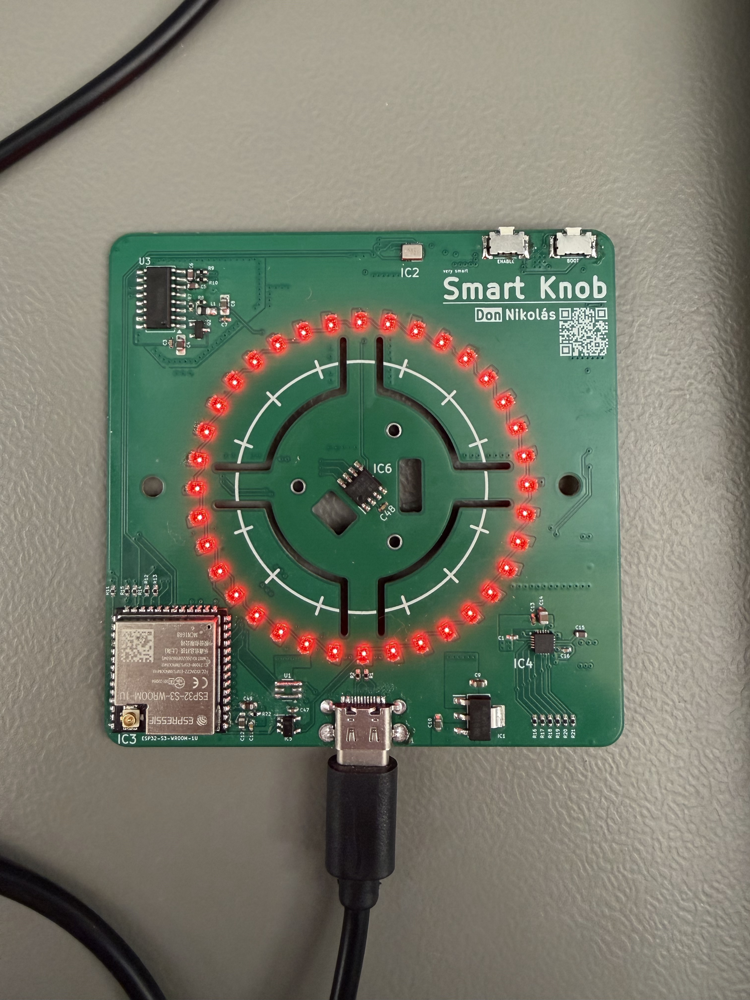
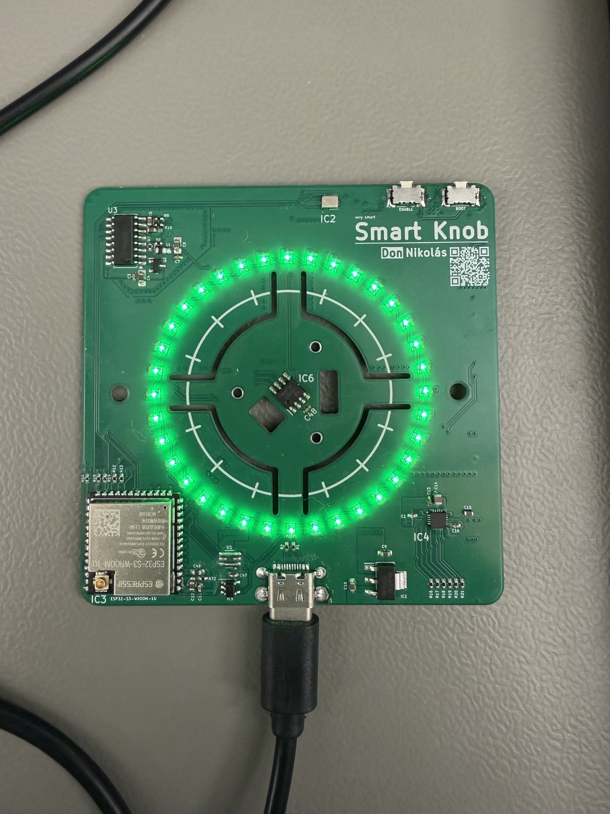
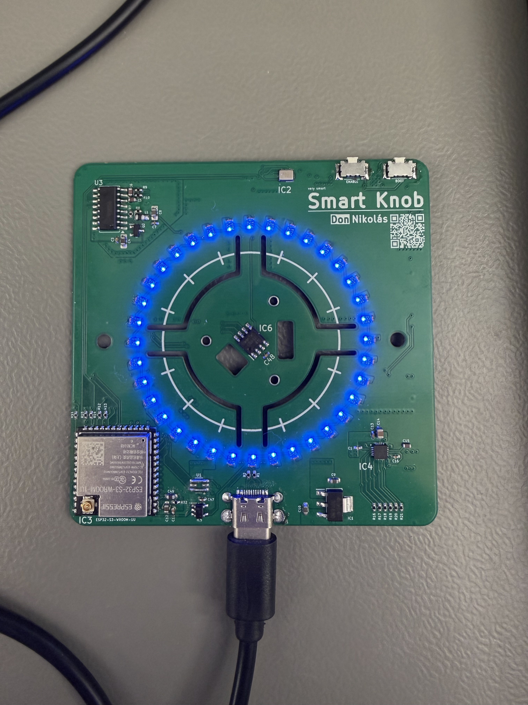
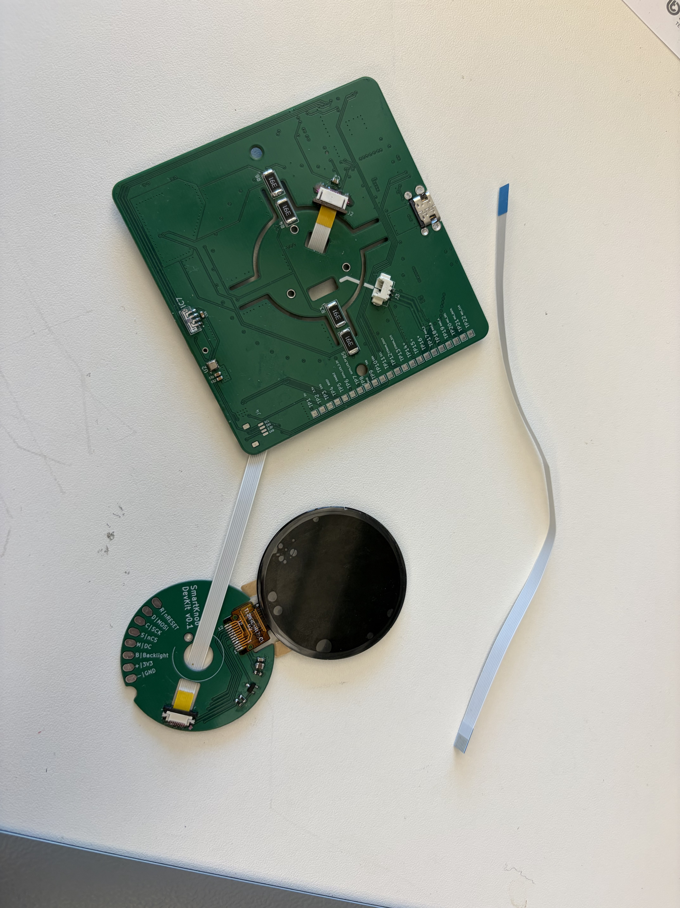

## Status

- PlatformIO build completed successfully.
- Firmware uploaded to the custom SmartKnob-NB PCB.
- Serial output ran for one minute without visible interruptions.

## LED ring test

Date: 2026-10-05

The test uses 36 LEDs on GPIO 11 with low brightness.

### Test sequence

- A single LED moves around the ring in red, green and blue.
- The whole ring then lights up in red, green and blue.
- The sequence repeats.

### Result

The firmware was built and uploaded successfully.
All 36 LEDs worked during the test, and the colours were correct.

### Test photos

## PSRAM test

Date: 2026-10-06

- Detected PSRAM: 8 MiB.
- Allocated a 1 MiB test buffer in PSRAM.
- All four write/read patterns passed.
- This was a basic function test, not a test of the entire 8 MiB.

The initial size check compared usable heap capacity with physical
memory size. This was corrected to query physical PSRAM size.

[Serial test output](docs/tests/psram-test.txt)

## AI assistance

ChatGPT generated the LED and PSRAM test code based on my requirements
and helped with the PlatformIO configuration and troubleshooting.
I built and uploaded both programs, tested them on my PCB and
recorded the results.

## Display test

Date: 2026-10-06

The display test runs on the current SmartKnob PCB with the display
adapter connected by a flex cable.

### Configuration

- GC9A01 display, 240 x 240 pixels.
- SPI clock: 1 MHz.
- Arduino_GFX: 1.4.7.
- LVGL: 8.3.11.

### Troubleshooting

The first flex cable produced an incorrect pin mapping.
After replacing it, the backlight worked but no image appeared.

Reducing the SPI clock from 20 MHz to 1 MHz did not fix the problem.
The display started working after I checked and resoldered its connections.
This suggests a solder connection problem.

### Result

The display test worked after resoldering.
The recorded test uses 1 MHz SPI. Higher speeds have not yet been
retested after the repair.

[Display test video](docs/images/Display-Test/display-test-demo.mov)

### AI assistance

ChatGPT generated the test code and helped with configuration and
troubleshooting. I checked the wiring, resoldered the display connections
and tested the hardware.

## BME280 test

Date: 2026-10-06

- SDA: GPIO 48.
- SCL: GPIO 41.
- BME280 detected at address 0x76.
- Sensor ID: 0x60.
- Initialization passed.
- Temperature, humidity and pressure readings were received every two seconds.

The basic function test passed. Measurement accuracy has not been
checked against a reference instrument.

Another I2C device responded at 0x10. Its function was not tested.

[Serial test output](docs/tests/bme280-test.txt)

ChatGPT generated the test code. I built, uploaded and tested it on my PCB.

## Microphone test — initial results

Date: 2026-10-07

- Microphone: ICS-41350.
- PDM clock: GPIO 38.
- Data: GPIO 39.
- Channel select: GPIO 40, LOW.
- PCM sample rate: 16 kHz, 16-bit mono.

The firmware built and uploaded successfully.
Sample data was received continuously during the office test.
RMS values ranged from 7.7 to 9.9 and peak-to-peak values reached 176.
No clipped samples were reported.

A clear response to controlled sound has not yet been confirmed.
Clap detection is not implemented. Further checks of the microphone
signal and shorter analysis windows are planned.

[Serial test output](docs/tests/microphone-test.txt)

ChatGPT assisted in generating the test code. I uploaded it and recorded the
measurements on my PCB.

## Microphone LED level test

Date: 2026-10-07

- Built and uploaded the `microphone_level` test successfully.
- Observed the LED ring reacting to speech and clapping.
- Set the full-ring display level to 3200.
- This value controls the display scale, not a clap detection threshold.
- Automatic clap detection has not been implemented yet.

ChatGPT helped create the diagnostic code.
I uploaded the firmware and tested it on my PCB.

### Hardware troubleshooting

The first microphone showed no clear response to sound.
Cleaning liquid entered the microphone opening while I cleaned
the PCB after hand-soldering nearby components.

After replacing the microphone, the LED level display responded
to speech and clapping. Liquid damage is suspected, but the exact
cause was not confirmed.

### Video

[Microphone LED level demonstration](docs/videos/microphone-level-demo.mp4)

## Double-clap detection prototype

Date: 2026-10-07

Two detected short impulses toggle the LED ring on or off.
The allowed interval between impulse starts is 120–550 ms.
After switching, a 1000 ms lockout prevents immediate retriggering.

### Initial result

The double-clap function worked during a short manual test.
The LED ring was used as the test light.

### Testing still required

- Count successful detections and missed double claps.
- Check false triggers from speech, music and other sudden sounds.
- Test different distances and background noise levels.
- Run longer tests without intentional clapping.

Reliable clap-only detection and a low false-trigger rate
have not yet been demonstrated.

ChatGPT helped develop the code.
I uploaded the firmware and tested it on my PCB.

## HX711 pressure-button test

Date: 2026-10-08

The test uses the HX711 with a Wheatstone bridge made from
four 390-ohm SMD resistors (R3–R6).

- Added a raw ADC test and a separate pressure-button test.
- Mounted the motor using the two Seedlabs mounting parts.
- Selected a switching threshold of 20000 ADC counts.
- Pressing toggles the LED ring on or off.
- The code requires release before another press can toggle the light.
- The unloaded zero point is set with `t`.
- `+` and `-` adjust the threshold during testing.

The initial manual test worked with the assembled mechanism.
Longer tests for repeatability, drift and false triggers are pending.
The readings are not calibrated force values.

The motor was mounted mechanically. Its electrical operation
has not been tested yet.

[Pressure-button demonstration](docs/videos/hx711-press-demo.mp4)

ChatGPT helped create the test code.
I assembled the hardware and performed the manual tests.

## Angle sensor test

Date: 2026-10-08

The MT6701 was tested with the motor mounted in the Seedlabs holder.
The motor driver inputs stayed LOW during the test.

### Results

- The displayed angle followed manual rotation in both directions.
- The stationary log contains 205 readings.
- The angle ranged from 348.79° to 349.10° while stationary.
- All readings reported `Field: TOO WEAK`.
- Six readings reported `Track: LOST`.
- Light pressure on the knob did not clear the field warning.
- Offline CRC checking of the recorded frames found no errors.
  The test firmware does not check CRC yet.

Angle readout works, but the magnetic field warning and tracking
loss still need investigation before closed-loop motor testing.
Angle accuracy has not been verified against a calibrated reference.

[Stationary test log](docs/tests/angle-sensor-stationary.txt)

### AI assistance

ChatGPT generated the test code and helped analyse the serial logs.
I built and uploaded the firmware and tested the sensor on my PCB.

### CRC diagnostics update — 2026-10-09

Added CRC checking and counters to the test firmware.

The last counter report from each test showed:

| Result | Slow rotation | Stationary |
|---|---:|---:|
| Sampled frames | 150 | 150 |
| Invalid frames | 0 | 0 |
| CRC errors | 0 | 0 |
| Weak magnetic field | 150 | 150 |
| Tracking lost | 5 | 3 |

Communication passed the CRC checks in these tests.
The weak-field warning and tracking loss remain unresolved.
The motor was not driven during these tests.