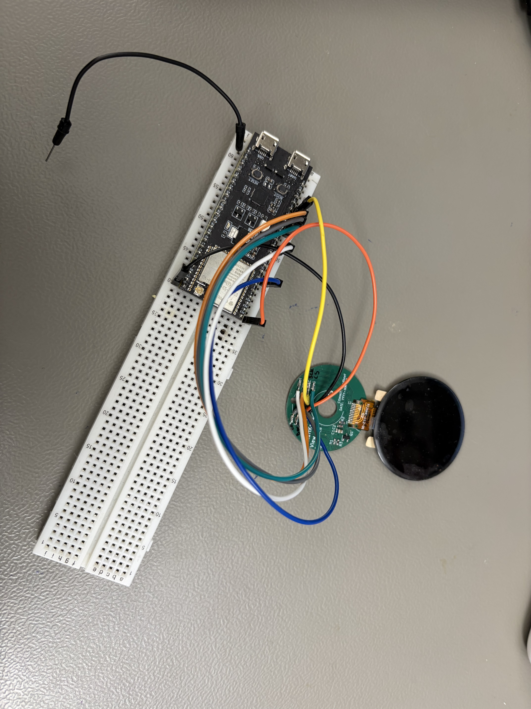

# Arduino Display Prototype

This earlier prototype is included as a visual and functional reference
for the SmartKnob display concept.

ChatGPT generated or revised substantial parts of the software based on
my requirements. I tested display functions on an earlier hardware setup.

## Contents

The prototype includes an animated menu, value screens, a Wi-Fi clock,
saved settings and display brightness control.

## Limitations

- It uses the old hardware pin assignments.
- It has not been validated on the current SmartKnob PCB.
- It must not be uploaded to the current PCB without adaptation.
- Wi-Fi credentials have been removed.
- Included test reports describe the earlier development stage.
- Original German comments and documentation are preserved as reference.

Current development and hardware test results are documented in
the firmware directory.

## Prototype demonstration

Recorded on 2026-10-06.

The video shows the display prototype running on a separate ESP32
DevKit connected to the display with jumper wires.
The photo shows the complete setup.

This demonstrates the earlier prototype on the DevKit.
The display has not yet been tested on the current SmartKnob PCB.

[Watch the demonstration video](media/display-prototype-demo.mp4)

